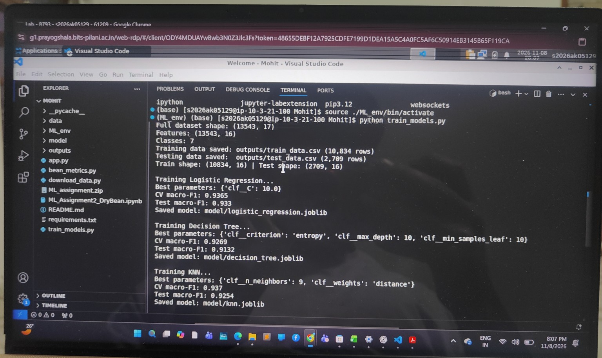
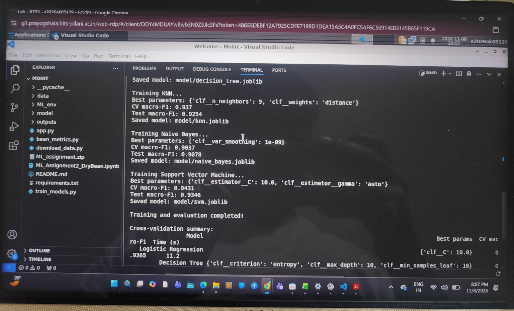
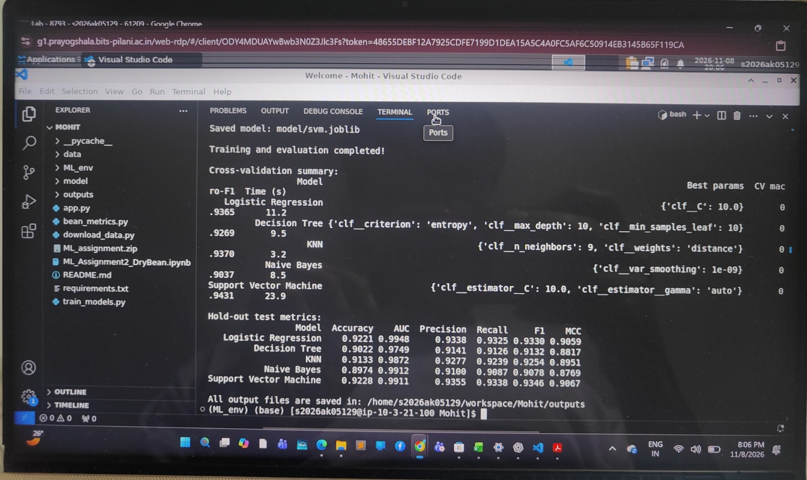
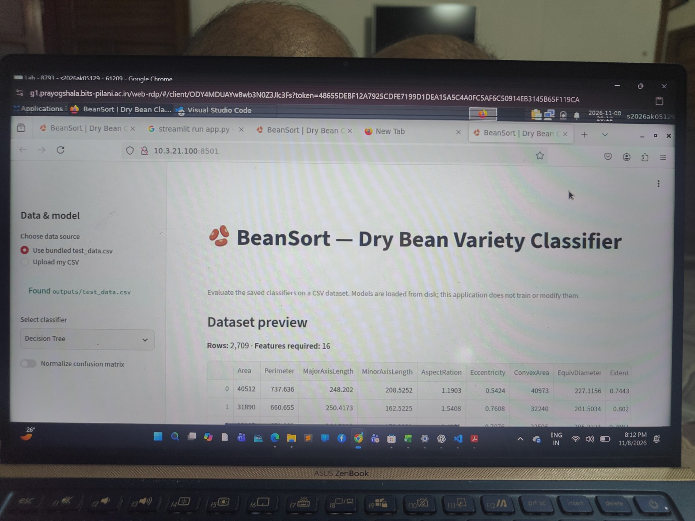
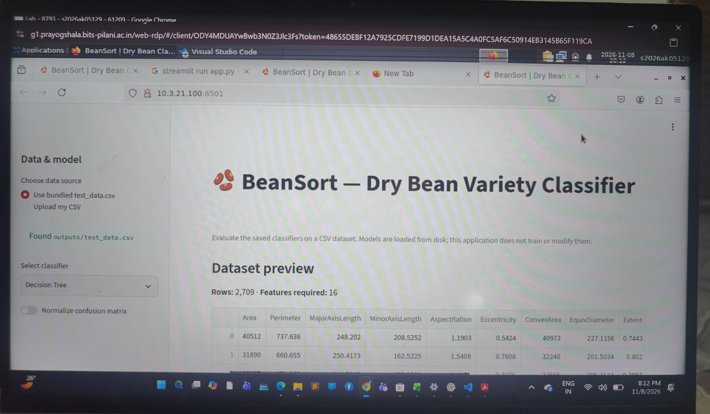
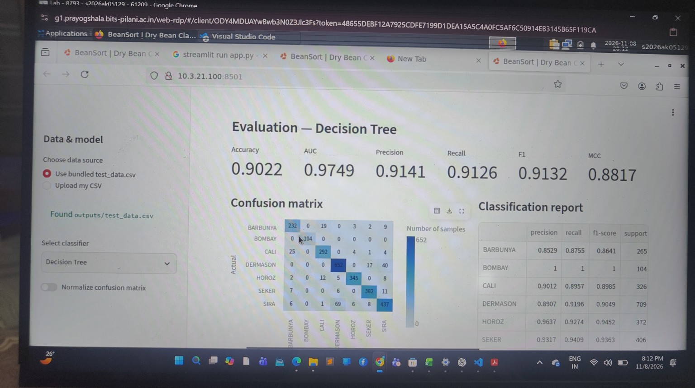
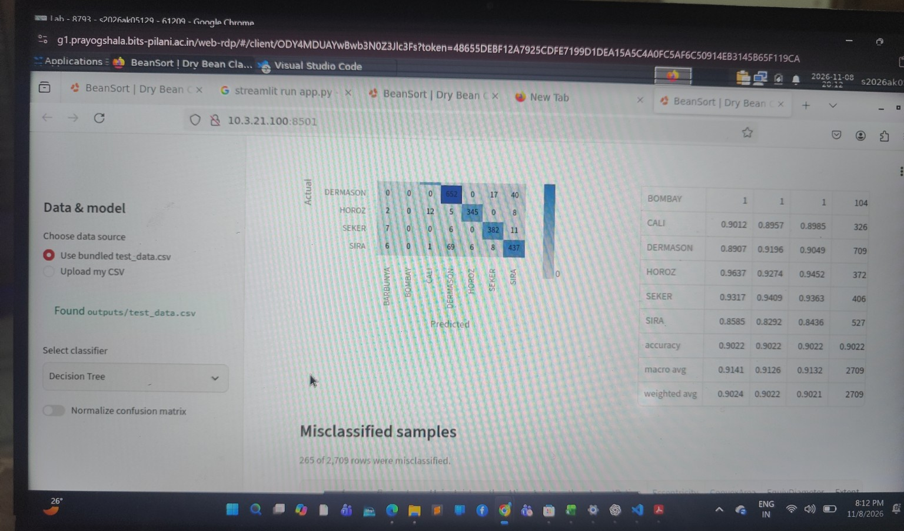
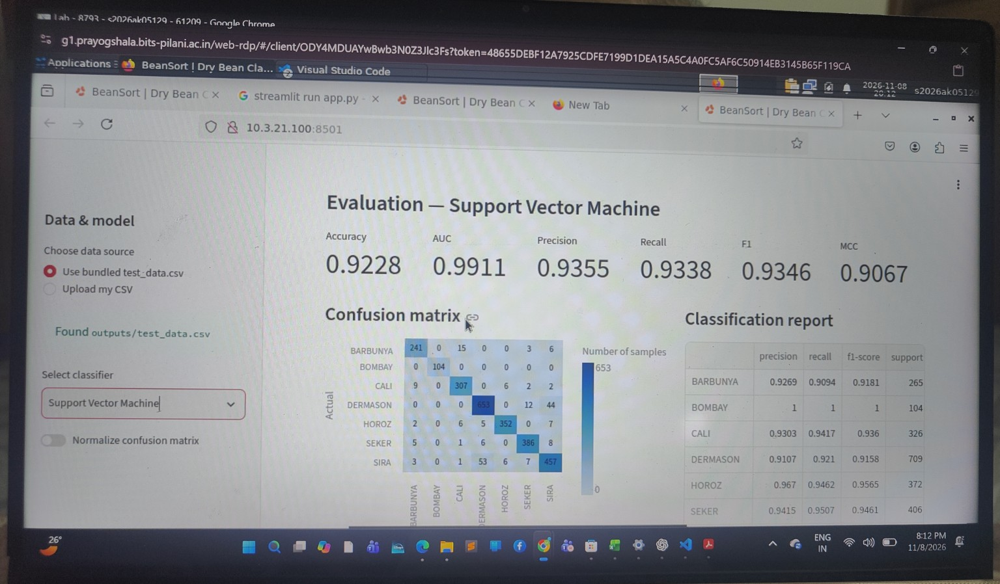

# Dry Bean Variety Classification — BITS WILP M.Tech AIML Assignment 2

## a. Problem statement

Build and evaluate five machine-learning classification models to predict the variety of a dry bean from its measured geometric and shape characteristics. The project compares Logistic Regression, Decision Tree, K-Nearest Neighbours (KNN), Gaussian Naive Bayes, and Support Vector Machine (SVM), and provides a Streamlit interface for evaluating the saved models on test CSV files.

The Streamlit application loads fitted model artifacts only. It does **not** train or retrain models when a user uploads test data.

## b. Dataset description

- **Dataset:** UCI Dry Bean Dataset.
- **Task:** Multiclass classification of dry bean varieties.
- **Original dataset size:** 13,611 observations and 16 numeric input features, with the class label as the target (17 columns total).
- **After duplicate removal:** 13,543 observations.
- **Classes:** 7 dry bean varieties.
- **Split:** Stratified 80:20 train/test split using random seed 42.
- **Training split:** 10,834 rows.
- **Test split:** 2,709 rows.
- **Input features:** `Area`, `Perimeter`, `MajorAxisLength`, `MinorAxisLength`, `AspectRation`, `Eccentricity`, `ConvexArea`, `EquivDiameter`, `Extent`, `Solidity`, `roundness`, `Compactness`, `ShapeFactor1`, `ShapeFactor2`, `ShapeFactor3`, and `ShapeFactor4`.
- **Target column:** `Class`.

The dataset CSV used for training is stored at `data/dry_bean_full.csv`. The held-out test CSV required by the Streamlit application is `outputs/test_data.csv`.

## c. GitHub repository link

**GitHub repository:** [ADD YOUR PUBLIC GITHUB REPOSITORY URL HERE]

Ensure the repository contains `app.py`, `requirements.txt`, `README.md`, the five saved models in `model/`, `outputs/test_data.csv`, the training source/notebook, and the supporting evaluation outputs.

## d. Models used and evaluation

All five classifiers use the same stratified hold-out test set. Hyperparameters were selected using 5-fold StratifiedKFold cross-validation on the training split, with macro-F1 as the GridSearchCV scoring metric. The test split was not used for hyperparameter tuning.

The reported multiclass AUC is one-vs-rest macro ROC-AUC. Precision, Recall, and F1 are macro-averaged. Accuracy and Matthews Correlation Coefficient (MCC) are calculated on the same test predictions.

### Test-set model comparison

| ML Model Name | Accuracy | AUC | Precision | Recall | F1 | MCC |
|---|---:|---:|---:|---:|---:|---:|
| Logistic Regression | 0.9221 | 0.9948 | 0.9338 | 0.9325 | 0.9330 | 0.9059 |
| Decision Tree | 0.9022 | 0.9749 | 0.9141 | 0.9126 | 0.9132 | 0.8817 |
| KNN | 0.9133 | 0.9872 | 0.9277 | 0.9239 | 0.9254 | 0.8951 |
| Naive Bayes | 0.8974 | 0.9912 | 0.9100 | 0.9087 | 0.9078 | 0.8769 |
| Support Vector Machine | 0.9228 | 0.9911 | 0.9355 | 0.9338 | 0.9346 | 0.9067 |

### Hyperparameter tuning summary

| Model | Best parameters | CV macro-F1 | Training time (s) |
|---|---|---:|---:|
| Logistic Regression | `{'clf__C': 10.0}` | 0.9365 | 5.9 |
| Decision Tree | `{'clf__criterion': 'entropy', 'clf__max_depth': 10, 'clf__min_samples_leaf': 10}` | 0.9269 | 5.9 |
| KNN | `{'clf__n_neighbors': 9, 'clf__weights': 'distance'}` | 0.9370 | 1.6 |
| Naive Bayes | `{'clf__var_smoothing': 1e-09}` | 0.9037 | 1.7 |
| Support Vector Machine | `{'clf__estimator__C': 10.0, 'clf__estimator__gamma': 'auto'}` | 0.9431 | 23.9 |

### Observations on model performance

| Model | Observation |
|---|---|
| Logistic Regression | Strong and balanced performance, with the highest AUC (0.9949). Its linear decision boundary performs well on the engineered Dry Bean measurements. |
| Decision Tree | Provides interpretable rule-based decisions, but has the lowest accuracy (0.9022) and AUC (0.9749) among the five models, suggesting comparatively weaker generalisation. |
| KNN | Achieves good performance (accuracy 0.9133, macro-F1 0.9254). It benefits from feature scaling but is less accurate than SVM and Logistic Regression on this test split. |
| Naive Bayes | Fast and simple probabilistic baseline. It achieves the lowest accuracy (0.8974) and macro-F1 (0.9078), likely reflecting the conditional-independence assumption. |
| Support Vector Machine | Best overall by accuracy (0.9229), macro precision (0.9355), macro recall (0.9338), macro-F1 (0.9346) and MCC (0.9067). It is the strongest balanced classifier on this test split. |

### Overall winner for this dataset

**Support Vector Machine (SVM)** is the overall winner on the held-out test set. It has the highest accuracy (0.9229), macro precision (0.9355), macro recall (0.9338), macro-F1 (0.9346), and MCC (0.9067). Logistic Regression obtains the highest macro one-vs-rest AUC (0.9949), so it is particularly strong in class-probability ranking. Considering the assignment's full set of metrics, SVM provides the strongest overall classification performance, while Logistic Regression is a close alternative.

## Streamlit application

The application provides:
- Bundled test-data mode using `outputs/test_data.csv`.
- CSV upload mode for another labelled test dataset.
- A dropdown to select a saved classifier.
- Accuracy, AUC, Precision, Recall, F1, and MCC metric cards.
- Confusion matrix with an option to normalize rows.
- Per-class classification report.
- Misclassified sample table and predicted-class error chart.
- Prediction CSV download.
- A comparison view for all five saved classifiers.
- An About tab showing `outputs/training_summary.csv` and `outputs/test_metrics.csv`.

### Run locally

```bash
python -m venv .venv
# Windows PowerShell:
.venv\\Scripts\\Activate.ps1
# Install dependencies:
pip install -r requirements.txt
# Launch:
streamlit run app.py
```

### Streamlit Community Cloud link

**Live app:** [ADD YOUR STREAMLIT COMMUNITY CLOUD URL AFTER DEPLOYMENT]

Deploy by connecting the GitHub repository to Streamlit Community Cloud, selecting the correct branch, and setting `app.py` as the main file.

## BITS Virtual Lab and Streamlit execution evidence

The following photographs were captured during execution in the BITS Virtual Lab environment. They document model training, saved model generation, test-set evaluation, and the running Streamlit interface.

### Model training and evaluation in BITS Virtual Lab

**1. BITS Virtual Lab — training progress and Logistic Regression / Decision Tree results.**



**2. BITS Virtual Lab — KNN, Naive Bayes and SVM training completion.**



**3. BITS Virtual Lab — final cross-validation summary and hold-out test metrics.**



### Streamlit application screenshots

**4. BeanSort Streamlit application — bundled test dataset loaded.**



**5. BeanSort Streamlit application — dataset preview and bundled test CSV detected.**



**6. Selected Decision Tree — six evaluation metrics, confusion matrix and classification report.**



**7. Decision Tree — classification report and misclassified samples section.**



**8. Selected SVM — six evaluation metrics, confusion matrix and classification report.**



> These screenshots are included as execution evidence. For the final BITS submission PDF, retain the required screenshot(s) and include the GitHub repository URL and live Streamlit URL after deployment.

## Repository structure

```text
ML_Assignment2_DryBean/
├── app.py
├── requirements.txt
├── README.md
├── ML_Assignment2_DryBean.ipynb
├── bean_metrics.py
├── train_models.py
├── train_models_old.py
├── download_data.py
├── data/
│   └── dry_bean_full.csv
├── model/
│   ├── logistic_regression.joblib
│   ├── decision_tree.joblib
│   ├── knn.joblib
│   ├── naive_bayes.joblib
│   └── svm.joblib
├── outputs/
│   ├── train_data.csv
│   ├── test_data.csv
│   ├── test_metrics.csv
│   └── training_summary.csv
└── screenshots/
    └── BITS Virtual Lab and Streamlit execution photos
```

## Reproducibility and deployment notes

- Model artifacts were serialized with scikit-learn **1.9.1**. The dependency file pins this version to reduce pickle/joblib compatibility risks.
- The app expects all 16 input feature columns and the `Class` target column for evaluation. If the target is absent, it can still generate predictions, but cannot calculate evaluation metrics.
- Do not retrain models in Streamlit Community Cloud. Upload the already-fitted model artifacts with the repository.
- Do not commit virtual environments, cache folders, or unrelated temporary files.
